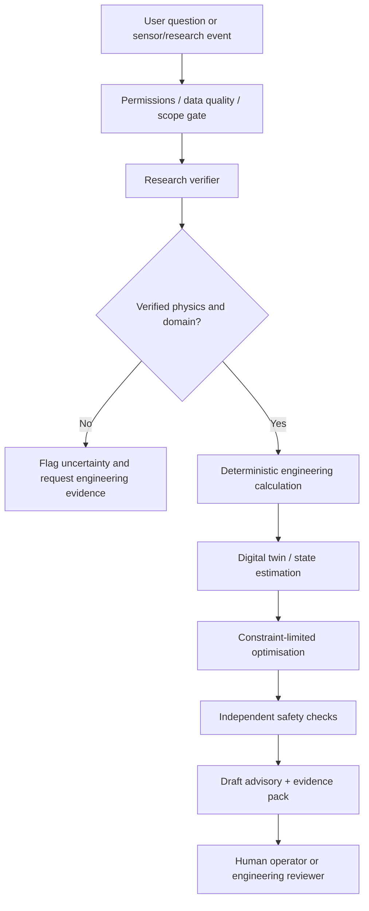

# Proposed orchestration workflow (not yet executable)

## Context standard
Every invocation has `trace_id`, `asset_id`, `requested_action`, `data_classification`, `role`, `snapshot_ts_utc`, `approved_source_hashes`, `model_version` and `solver_version`.

## Artefacts
`EvidenceBundle`: claim -> URL/DOI -> scenario -> units -> peer/source tier -> verified status.
`CalculationBundle`: input schema version, solver hash, units, outputs, validity and uncertainty.
`AdvisoryBundle`: options, constraints, economic/safety assumptions, abstentions, explanations, reviewer and decision.
No output includes a command to physical equipment.

## Fail-closed cases
Source citation not verified, out-of-range T/P, sensor gap, drift, unexpected phase, missing SOP, unknown asset, overridden safety limit or missing expert sign-off -> STOP ADVISORY, ESCALATE.

## Implementation backlog
- Create JSON Schema/Pydantic definitions for bundles.
- Retrieval with citations and access control to markdown research and primary papers.
- Evaluation fixtures (hallucination, prompt injection, numeric contradiction and domain escape).
- Orchestrator with role-based least privilege; immutable audit stream; no actuator token.
- Add a read-only pilot only after legal, cyber, and process-safety review.
