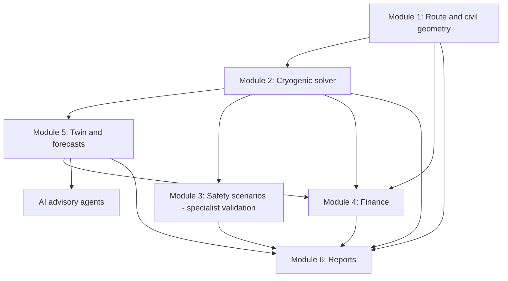

# Module dependency map and data contracts

## Shared contracts (future)
`RunContext`: run ID, timestamp UTC, revision hashes, parameter references, unit registry, model version, quality flags.

`Asset`: site/tank/cable-segment ID, equipment revision, data rights, location sensitivity, calibration metadata.

`Measurement`: asset ID, variable, SI unit, time UTC, value, quality, origin, bounds.

`PhysicsResult`: output SI units, scenario, model limitations, input hashes, claim/evidence IDs, validation status.

`Recommendation`: options ranked by forecasted cost or risk, hard constraints, confidence, supporting PhysicsResults, human approver; never directly maps to an actuator command.

## Agent boundary
Agents can annotate research/interpret checked solver outputs and prepare draft reports. They must not manufacture pressure, safety, regulation or cost results. The physics and permissions service is the system of record.
