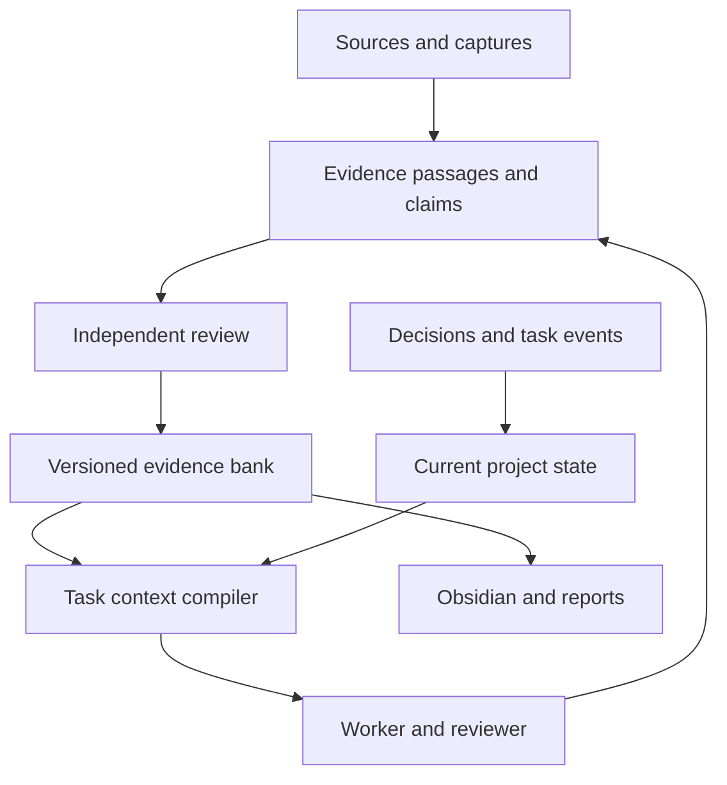

# Context bank assessment and reusable project blueprint

Assessment date: 31 October 2026. Inspected evidence baseline: `9efb44591cfc3db1ad1f55c84010846e12bcb8a9`. Scope: the US integrity research domain inside PipeMind. This document assesses the existing implementation and proposes improvements; the proposed components have not been implemented by writing this report.

The bank already preserves research, sources, uncertainty and review unusually carefully. Its next useful development is a reliable way to turn that material into the right working context for a particular decision. More notes and more agent definitions will not by themselves accomplish that.

Three separate native reviewers inspected graph structure, agent coordination and evidence quality. The coordinator inspected the implementation and records, verified the remote draft PR head against the local commit, and reran the public graph validator successfully. The 223-test result below is the retained clean-export result for the preceding delivery; that whole suite was not rerun for this documentation-only assessment.

## 1. Current inventory and what the numbers mean

| Measure | Inspected state | Interpretation |
|---|---:|---|
| Canonical graph nodes | 1,500 | Includes sources, plans, roles, observations and hypotheses; not 1,500 discoveries |
| Graph edges | 3,733 | Includes citations, assignments and organizational structure, as well as evidence relationships |
| Citation edges | 2,015, about 54% | Valuable traceability; not buyer-to-supplier transaction links |
| Source records | 448 | Dated/source-specific records, not necessarily independent documents |
| Unique source URLs | 342 | Repeated URLs can legitimately have separate observations or capture scopes |
| Source records marked bytes archived | 150 | Each has a content hash and snapshot path; scopes include selections and derived records, not necessarily complete original documents |
| Source records marked not byte archived | 298 | Consultation is recorded; a reproducible original-byte archive is not claimed |
| Obsidian node notes | 1,500 | One generated note per graph node |
| Notes including navigation | 1,501 | The vault folder exists in the repo; desktop installation/sync is not established |
| Node / edge type strings | 98 / 160 | Flexible domain expression, with growing need for controlled schemas |
| Approved investigation extensions | 5 | Additive, reviewed, digest-pinned bundles |
| Sector scopes | 27 | Catalogue coverage, not 27 completed sector audits |
| Foundation work packages | 24 | A separate initial task plan |
| Focused price role contracts | 14 | Versioned specialist instructions, not continuously running model services |
| Focused price tasks | 20 | Retained run: 4 accepted, 5 blocked, 11 queued |
| Gated later sector waves | 8 | Proposed expansion |
| Retained clean-export tests | 223 passing | Software and evidence-control tests; not measured fraud-detection accuracy |
| Newly established fraud cases | 0 | The current case remains an unqualified pricing question |

At this baseline there are 2,145 tracked files under `research/us-integrity`; 1,505 are generated outputs. That is storage organization, not a research performance measure. The canonical graph file is 3,003,484 bytes. Loading the entire bank into every agent is an inefficient default.

The graph's status distribution is 721 `documented_fact`, 448 `source`, 174 `planned`, 48 `hypothesis`, 43 `allegation`, 32 `published_case`, 13 `conviction`, 12 `unknown`, 8 `audit_finding` and 1 `disputed`. A `documented_fact` can mean that a seller advertised a price or a retrieval returned an application shell. It does not certify every implication an analyst might draw from that observation.

Counts were read from the canonical graph and checked against [coverage-summary.json](../data/coverage-summary.json) and [manifest.json](../generated/manifest.json). Archive counts use `properties.source_bytes_archived`; the 150 true records also carry `content_sha256` and `snapshot_path`. These flags have heterogeneous scopes and must not be summarized as 150 preserved complete originals.

## 2. How the bank works today

| Layer | Location | Actual function |
|---|---|---|
| Orientation | [START-HERE.md](../START-HERE.md) | Human overview, latest case and links |
| Assembly inputs | `data/registries/`, `reports/`, approved connector captures and investigation extensions | Authoritative ingredients for a repeatable graph build |
| Assembly controls | [tools/assemble.py](../tools/assemble.py), [tools/investigation_extensions.py](../tools/investigation_extensions.py) | Admit approved inputs, verify digests and reject collisions |
| Canonical graph | [data/graph.json](../data/graph.json) | Materialized public evidence model assembled from reviewed inputs |
| Investigation dossiers | `investigations/` | Source selections, query logs, analyses, findings, failures, reviews and input receipts |
| Local engine | [engine/integrity.py](../engine/integrity.py) | Validate graph, generate notes/CSV/SQLite, search and manage the foundation task queue |
| Focused research runtime | [price-agents/runtime/agent_runtime.py](../price-agents/runtime/agent_runtime.py) | Richer local tasks, leases, attempt budgets, evidence, results, review and reopening |
| Human reading views | [generated/obsidian/00-START-HERE.md](../generated/obsidian/00-START-HERE.md), `generated/exports/` | Obsidian notes/backlinks and portable tables |
| Cross-session exchange | [collaboration/](../collaboration/README.md) | Commit-pinned tasks, result contracts and manual handoff records |
| Verification | [VALIDATION.md](../VALIDATION.md) and dossier review receipts | What was checked, at which version, with what limits |

The graph is canonical for its generated views, but it is itself assembled. Editing a generated note directly does not update its source records. The safe authoring path is reviewed input or successor extension, then assembly and validation, then regenerated views.

The evidence lifecycle already has a useful shape: acquire a bounded record, retain the available evidence with its scope, normalize identities and amounts, formulate a bounded claim, challenge it separately, approve a specific version, then export it. Unapproved folders do not automatically enter the public graph.

The Obsidian vault is a reading interface. Each note contains stable ID/type/status, JSON properties, source links, outgoing relationships and backlinks. It does not independently run agents, load all context into a model, update the graph from free-form edits, or train model weights.

The search engine uses SQLite FTS5 over node titles and serialized properties, with a literal `LIKE` fallback. Results contain ID, type, title and status; the default limit is 20, capped at 100. It currently does not index every report or original document, retrieve precise supporting passages, assemble chronology, expand relevant graph paths, or create a bounded evidence packet for an agent.

## 3. What the research memory actually contains

The bank preserves several kinds of work that should stay distinguishable:

1. **Broad domain orientation.** Twenty-seven scopes, source catalogues, ownership/commerce guidance, published enforcement/audit examples, method hypotheses and specialist assignments. These help choose questions; they do not establish full population coverage.
2. **Bounded data acquisitions.** The foundation has 65 selected public award rows. Later work includes a 150-award supplier-name control and a 30-award DLA/VA/HHS pilot. Sampling, pagination and amount-basis limitations are preserved. These counts should not be added into a unique nationwide buyer total.
3. **A completed public catheter analysis.** All 6,870 published rows for the selected three codes and years were acquired and analyzed. This maps a known public case and its unresolved questions; it did not discover a new fraud.
4. **The common-bolt dossier.** Original procurement evidence supports 906 units at $0.91, or $824.46 ordered. New seller evidence supports an advertised $190.49 carton of 1,100 commercial bolts. The authoritative technical match, relevant-date feasible offer, actual selection record, payment and buyer benefit remain unestablished.
5. **A separate specialty-bolt pilot.** A different NSN has 2,243 production units at $272.99 plus a $3,500 first-article test. Keeping these distinct prevents an invalid comparison merely because both descriptions contain “bolt.”
6. **Method and failure memory.** The system retains rejected comparators, source access failures, synthetic 12% controls, denominator checks, duplicate-transaction warnings, insufficient evidence and exact reopening conditions.
7. **Execution and review memory.** Task contracts, assignments, receipts, input commits, accepted packets and independent challenges record what workers actually did.

The current case demonstrates why uncertainty is useful memory. A price advertisement, an ordered amount, a fair-price assessment, an improper purchasing decision, cash loss and a benefit to an individual are different claims. Retaining the missing links is more valuable than producing a confident combined narrative.

## 4. Strengths worth preserving in every future project

**Evidence is connected to its origin.** Stable IDs, source references, selected locators, hashes and input commits make review possible. A hash proves that particular bytes have not changed relative to a recorded digest; it does not prove publisher identity or factual truth by itself.

**Earlier work is not silently overwritten.** Five approved investigation extensions preserve dated findings. Successor evidence can narrow earlier observations while retaining the history.

**The bank records meaningful negative outcomes.** “Specification missing,” “this is a contract ceiling,” and “the source is an application shell” are valid results. They prevent later agents repeating the same mistake or overstating an incomplete chain.

**Measurements retain their meaning.** Ordered value, obligations, actual payment, alleged loss, settlement and estimates are distinct. Construction projects need the same discipline for design volume, surveyed volume, loose volume, compacted volume and paid quantity.

**Production and review are separated.** A researcher cannot simply label its own result accepted. Reviewers can accept a correctly worded unknown. Separate model sessions still do not constitute an independent external audit, and role labels alone do not authenticate the reviewer.

**Local coordination has real controls.** SQLite transactions, expiring leases, fencing tokens and append-only operational records address duplicate claims and stale-worker writes when workers share the same actual database.

**The files are portable.** Markdown, JSON, CSV, Python and SQLite support future use by different models without dependence on proprietary chat memory.

## 5. The main weaknesses, with concrete examples

**Current state must be reconstructed manually.** `CONNECTION-STATUS.json` retains a Claude handoff described as in progress; `CODEX-TAKEOVER-2026-10-30.md` supersedes that assumption after the user reported exhausted usage. The price-task plan centers the specialty-bolt pilot, while the later dossier focuses the common bolt. Historical validation sections retain older counts and digests. These can all be correct at their recorded times, but retrieval needs an authoritative current view.

**The data vocabulary is drifting.** There are 98 node types and 160 edge types. Source fields vary among `source_kind`, `source_type`, `source_class` and `evidence_class`; dates similarly use several names. The engine accepts extensible nonempty type strings. Detailed per-type meaning and temporal correctness rely heavily on prose and reviewers. Flexibility is useful, but equivalent facts need predictable fields before cross-project automation grows.

**Sources, captures and extracted assertions are not uniformly separate objects.** Some source records represent a webpage consultation, others a selected extraction or request/response capture. A consumer must interpret several archive-scope fields to determine what is actually reproducible. Separate these concepts in a successor schema, preserving existing records as legacy versions.

**Retrieval is less developed than preservation.** The bank can retain a caveat without guaranteeing a new agent retrieves it beside the associated price. The graph also does not yet provide a general resolver for current/superseded claims or contradiction-aware task context.

**Coordination has several generations.** The foundation queue, Claude/Grok JSON queue, richer price runtime and latest narrative run ledger represent execution differently. They should be readable through one current view, without fabricating historical claims or translating “searched” into “resolved.”

**Acquisition accounting is fragmented.** Searches, page opens, document reads, local finds, HTTP requests and cache reuses are not interchangeable. The standalone tracer has not demonstrated successful live acquisition in this environment; its recorded trial stopped at DNS. Other research routes succeeded. There is no integrated global request budget covering every script and model tool.

**Review can become unnecessarily expensive.** Broad byte-pinning protects evidence but can make a harmless narrative edit require a new large receipt. Immutable source/claim versions should be separated from mutable navigation. Changed substantive claims need review of their dependencies; every overview wording change need not behave like changed evidence.

**There is no demonstrated test of memory usefulness.** The retained 223 tests cover many engineering failures. They do not establish that a new agent can recover the current answer, avoid stale context and identify the correct next record in a small reading budget. No `.github` workflow directory was present on the inspected branch; retained test evidence is not a verified continuous CI service.

## 6. A reusable architecture for future projects

Separate a small common evidence/coordination core from domain-specific records and methods. Keep the present project intact while introducing versioned adapters; do not rewrite reviewed historical evidence to make it look native to a newer schema.

| Memory layer | Contents | Update rule |
|---|---|---|
| Project contract | Goal, scope, success criteria, constraints, permitted actions and relevant preferences | Explicit versioned changes |
| Evidence archive | Source records and actual retained capture bytes/selections with scope | Immutable captures; new captures receive new IDs |
| Claims and entities | Bounded assertions, measurements, identity matches and relationships | New reviewed versions; preserve conflicts and uncertainty |
| Decisions and current state | Accepted approach, rationale, alternatives, active objective, blockers and next action | Regenerated from authoritative decisions/events |
| Tasks and runs | Assignments, attempts, results, reviews, changes and action receipts | Append events; derive current status |
| Methods | Reusable procedures, schemas, checks, lessons and templates | Version with compatibility and evaluation records |
| Working context | A small packet assembled for one question/session | Disposable derivative; always traceable to inputs |

A task-specific packet should combine current decisions, the relevant facts and the evidence behind them. Working memory is deliberately smaller than stored memory.

A proposed reusable layout is a `core/` directory for schemas, retrieval, validation and projection; `projects/<project-id>/` for contract, decisions, claims, tasks and reviewed bundles; a separately controlled capture store; and `generated/` for SQLite, Obsidian and task packets. This is a blueprint, not an instruction to reorganize the existing repository immediately. Sensitive project evidence needs a real access boundary, not just a folder label in a public repository.

The core objects should be simple and explicit:

| Object | Required meaning |
|---|---|
| Source | Publisher, canonical address, source family and stated publication/version information |
| Capture | What was actually acquired, when, by which route, status, bytes, hash and archive scope |
| Evidence span | Page/table/row/section locator, exact retained excerpt or structured selection, parent capture and extraction method |
| Claim | One reviewable assertion, source spans, scope, qualifiers, evidence status and limitations |
| Entity / relationship | Stable project identity, external identifiers, role, asserted relationship and relevant time |
| Decision | Choice, rationale, options considered, evidence basis, owner and reopening trigger |
| Task / run | Question, inputs, dependencies, worker/session, budget, attempts and result |
| Review | Exact claim/result version, checks performed, decision, limits and reviewer/session |

W3C PROV-O's distinction between entities, activities, agents and derivation provides a useful reference for interoperability. Use the concepts without assuming a full RDF/ontology platform is necessary. See the [W3C recommendation](https://www.w3.org/TR/prov-o/).

## 7. Build an authoritative current-state manifest first

Create a generated `CURRENT.json` with the active objective, selected project/case, accepted baseline, latest decision IDs, active and blocked tasks, verified integration states, next evidence gates and pointers to superseded records. Pair it with a readable `CURRENT.md`.

Do not make a tracked file claim its own containing commit hash; that is self-referential. Store the inspected baseline and content digests, then publish the resulting commit in an external release/handoff receipt or compute it when a reader loads the checkout.

For this project, the current view would say: common-bolt specification/bid gate unresolved; no qualified comparator or established loss; Claude work taken over without an authenticated external result; five-specialist successor dossier available; previous specialty-bolt plan preserved as historical. Its generated date must not masquerade as a fresh verification date for every underlying source.

Acceptance test: a fresh session identifies the active case, latest conclusion, exact blocker and correct next record from this entrypoint without reconstructing the entire chat or reading every historical report.

## 8. Build task-context compilation second

Start with exact ID lookup and existing keyword search. Extend the index to approved report passages and source selections. Use project/visibility filters before retrieval. Follow a bounded set of relevant links, then attach evidence, contradictions, prior failures and chronology. Deduplicate repeated captures and shared upstream evidence without deleting valid dated observations.

SQLite FTS5 already supports ranked full-text search and snippets; this makes it a practical starting point for extending the existing implementation. A vector index is optional later, justified by measured retrieval failures rather than the size of the ambition. See [SQLite FTS5 documentation](https://www.sqlite.org/fts5.html).

Each packet should contain:

- The precise question and definition of completion.
- Project authority, relevant constraints and allowed actions, separate from untrusted source text.
- Current decision and relevant prior decisions.
- Exact entities, IDs, units and dates.
- The strongest relevant accepted claims with supporting evidence spans.
- Contradictions, caveats and alternative explanations beside those claims.
- Prior attempts, failure reasons and explicit conditions for trying again.
- Missing evidence and the next action that could change the decision.
- Input commit/digests, retrieval policy version and packet generation time.
- A size budget and manifest of omitted material, with reasons and drill-down links.

An initial 3,000–6,000-token packet budget is an engineering starting point to evaluate, not a universal limit. Complex tasks may need more. Preserve decisive caveats even when truncating less relevant narrative. Do not silently omit conflicting evidence to fit a budget.

A packet for “Is the $190.49 carton a valid benchmark?” should include the exact commercial SKU/pack/observation date, the 906-unit order, the missing authoritative specification, applicable procurement terms, the relevant review and the exact technical route's shell-only result. It should not import thousands of unrelated healthcare nodes.

Record what was actually supplied to each worker. Otherwise, a correct fact in the bank can be mistaken for a fact that the worker had access to when making its decision.

## 9. Improve claim, time and correction handling

Separate dimensions currently compressed into a single status. Useful fields include `record_kind`, `evidence_status`, `review_state`, `lifecycle_state`, `visibility` and freshness policy. Avoid arbitrary confidence percentages. Report completeness of the necessary evidence gates instead.

Use explicit unknown states instead of ambiguous Booleans. The current Nationwide observation has `government_equivalence: false` alongside explanations that equivalence is unverified. A future consumer could misread that as evidence that the products are different. A successor schema should use `equivalence_status: unverified`, `confirmed` or `rejected`, with the relevant evidence; preserve the frozen original and map it explicitly. The difference between “not demonstrated” and “demonstrated false” matters in every project.

For time, distinguish the event date, source publication date, capture time, asserted validity interval and time the bank learned the assertion. Unknown dates stay unknown. A current corporate record does not automatically establish ownership at an earlier purchase; a new drawing revision does not change the historical record of which revision was used for an earlier quantity calculation.

Make `supports`, `contradicts`, `qualifies`, `supersedes` and `derived_from` explicit, validated relationships. Corrections should identify the affected claim and downstream conclusions. When an input changes, mark dependent calculations/decisions as needing review; a changed URL alone is not necessarily changed evidence.

Group evidence by actual origin. Three agents repeating one seller listing are one underlying observation with multiple reviews. Several merchants sharing an upstream catalogue are not automatically independent market benchmarks. Keep capture IDs separate while recording common source lineage.

Define an evidence-span policy: exact page/table/row anchors, unit headers and footnotes must travel with extracted values. A PDF paragraph, a drawing dimension and a spreadsheet cell need different locators. Preserve table semantics when chunking rather than cutting every fixed number of characters.

Keep bulk rows in typed analytical tables. Create a graph node or Obsidian note when an object needs individual identity, linking, review or a decision. Turning every number and routine log event into a note can make the bank harder to use.

## 10. Improve the agent operating model

Define roles around evidence responsibilities. For a new project, begin with a coordinator, one or two collectors/analysts and a reviewer. Add specialist roles when the actual problem requires different expertise or parallel independent work. Fourteen available role contracts do not require fourteen workers for every task.

Use one versioned task/result/review envelope. Read historical formats through adapters. Include exact input versions, expected output fields, source permissions, finite budgets, disconfirmation conditions, review requirements and reopening triggers.

Persist one acquisition event model that distinguishes logical attempt, tool invocation, HTTP request, redirect, bytes, local cache reuse and retained artifact. Unknown counts must remain unknown. Integrate each adapter with the runtime before claiming a global budget is enforced.

Keep manual model exchange valid and explicit. A Claude or Grok worker can take a commit-pinned packet and return an artifact receipt without a live API bridge. Names in a file are not dispatch receipts. Do not invent model version, token usage or provider execution details when unavailable.

For separate machines, Git exchanges artifacts but does not provide a shared task lease. Use one coordinator initially. Introduce a shared transactional service only when real concurrent operations require it, with authenticated actors and idempotent results. Do not place a live SQLite database under Git and describe it as distributed coordination.

Record external action receipts separately from research conclusions. Future software/business projects may deploy, publish or send messages; the task system should distinguish proposed action, authorized scope, attempted action and verified outcome to prevent duplicate execution.

## 11. Make Obsidian easier to use

Keep generated evidence notes reproducible and clearly marked. Provide a separate authored inbox/working-notes area whose content enters the graph only through review. A generated view and a free-form authored note should never silently compete as the canonical value.

Generate focused indexes for current questions, open evidence gaps, recent changes, unresolved contradictions, decisions awaiting review and reusable methods. Default to a local case graph or filtered graph; the whole graph is better for orientation than checking one procurement chain.

Promote common scalar fields such as project, claim status, review state, source date and active/superseded state into consistent frontmatter. Keep complex nested evidence in JSON or rendered tables. Obsidian supports property search and typed properties, but nested properties are not supported by its ordinary properties interface. See [Obsidian properties documentation](https://help.obsidian.md/properties).

A good decision note answers: what is being decided; what is known; what contradicts it; what remains unknown; why the present choice was made; what would change it; and where the supporting evidence lives. Several compact decision pages can be more useful than thousands of uniformly rendered JSON notes.

## 12. Measure the bank's usefulness

Build an evaluation set from actual questions and known failure modes. Evaluate a new retrieval/summary process against a stable source version, then test current-state handling separately as new evidence arrives.

| Evaluation | What a successful result shows |
|---|---|
| Fresh-session resumption | Active objective, accepted conclusion, blocker and next action recovered correctly |
| Evidence retrieval | Required source passages appear among the supplied results |
| Citation correctness | Each material assertion is supported by the cited passage as worded |
| Temporal correctness | Historical/current versions and observation/event dates stay distinct |
| Counterevidence retention | Material contrary evidence survives summarization and context limits |
| Identity and units | No name-only merge, mixed NSNs, pack/unit confusion or ceiling/payment substitution |
| Change handling | New evidence invalidates or reopens the correct dependent decisions |
| Repeated-work control | Known failed routes are retried only for a recorded new reason |
| Reproducibility | A clean checkout reproduces approved outputs from retained inputs |
| Domain isolation | A construction or hydrogen task does not inherit fraud hypotheses or unrelated project assumptions |

Start with 20–30 carefully reviewed questions, not hundreds of generated easy examples. Include “What did Claude actually return?”, “Is $824.46 ordered or paid?”, “Which exact record unblocks the comparison?”, and “Why is this offer still unqualified?” Measure errors and necessary evidence omissions, context volume, repeat acquisitions and time to a supported decision. Do not use model self-grading as the only judge.

Add a one-command offline verification entrypoint, then a CI workflow that runs schema checks, link checks, relevant tests, digest verification and deterministic projection checks. Live-source tests should be a separately authorized bounded activity so ordinary verification does not silently contact websites or change evidence.

## 13. Practical build order

| Order | Deliverable | Completion condition |
|---|---|---|
| 1 | `CURRENT.json` and readable current dashboard | Resolves active case, authoritative versions, superseded plans, blockers and integration state |
| 2 | Core schema registry plus legacy adapters | Equivalent records query consistently; historical evidence remains unchanged |
| 3 | Passage index and task-context compiler | Produces a small source-linked packet containing decisive caveats and prior failures |
| 4 | Fresh-session evaluation set and offline verification command | Demonstrates reliable resumption and rejects known context errors |
| 5 | Unified task/event/acquisition envelope | One end-to-end acquisition → evidence → review → graph → context flow is reproducible |
| 6 | Generated decision/gap/change views | User can see what changed and what matters without reading every file |
| 7 | Freshness and dependency invalidation | A changed source or claim flags the affected downstream decisions |
| 8 | Additional connectors, semantic retrieval or remote orchestration | Added only for a measured need with an evaluated benefit |

Keep the established Python/SQLite/Git implementation for the first stages. This is an incremental improvement of an existing stack. A new graph database, paid embedding service or always-on agent platform is not required to prove these improvements.

A useful vertical slice is the current common-bolt question: source selection → typed claim → separate review → current decision → small context packet → a fresh worker's correct answer. Make that reliable before scaling another sector or importing another project.

## 14. How to start the next project

Write a short project contract before broad research: the decision to support, scope and exclusions, authoritative source families, identifiers/units, permitted actions, success criteria and who reviews what. Choose one real decision as the first end-to-end test.

For a construction project, domain records might include drawing number/revision, survey date, coordinate system, level datum, material class, phase, quantity basis and RFI status. For software, they might include requirement, code commit, test result, dependency version and deployment receipt. For business research, they might include market definition, dated offer, metric basis and investment assumption. Reuse provenance, decisions, tasks and review machinery; define evidence gates for the new domain.

At each session start, inspect the current manifest, load the selected task packet, verify the relevant baseline and take a bounded assignment. At each session end, retain new evidence and attempts, submit structured claims and review, record decisions and unresolved gaps, regenerate the current view, and publish a handoff receipt.

A reusable instruction for the next project is:

> Create a project context bank around this goal and definition of done. Separate source captures, claims, decisions, tasks and current state. Give every material claim stable identity, exact evidence locators, dates, units and review status. Preserve uncertainty and counterevidence. Start with one complete workflow and demonstrate that a fresh session can resume it from a small generated context packet. Reuse the common engine while keeping this project's assumptions and data isolated. Report what is implemented, what has actually run, what remains blocked and the next record or action that would change the decision.

The immediate engineering priority is a reliable current view plus task-context assembly. Those two components would make the existing evidence much easier to reuse, reduce repeated investigation, and expose missing information before more agents spend time searching.

## Evidence and assessment boundaries

Repository anchors: [engine manual](../engine/README.md), [graph schema](../engine/graph.schema.json), [current graph](../data/graph.json), [approved extensions](../data/approved-investigations.json), [focused runtime](../price-agents/README.md), [latest case](../investigations/single-case-followup-2026-10-30/REPORT.md), [latest validation receipt](../investigations/single-case-followup-2026-10-30/VALIDATION.json), [takeover note](../collaboration/CODEX-TAKEOVER-2026-10-30.md).

External references above were consulted on 31 October 2026 for provenance concepts, existing SQLite retrieval capabilities and Obsidian properties. Proposed priorities, packet budgets, evaluation design and architecture are recommendations from this assessment. This document does not add evidence claims to the research graph, change frozen review packets, establish a newly discovered fraud, activate a model service or merge the branch.
