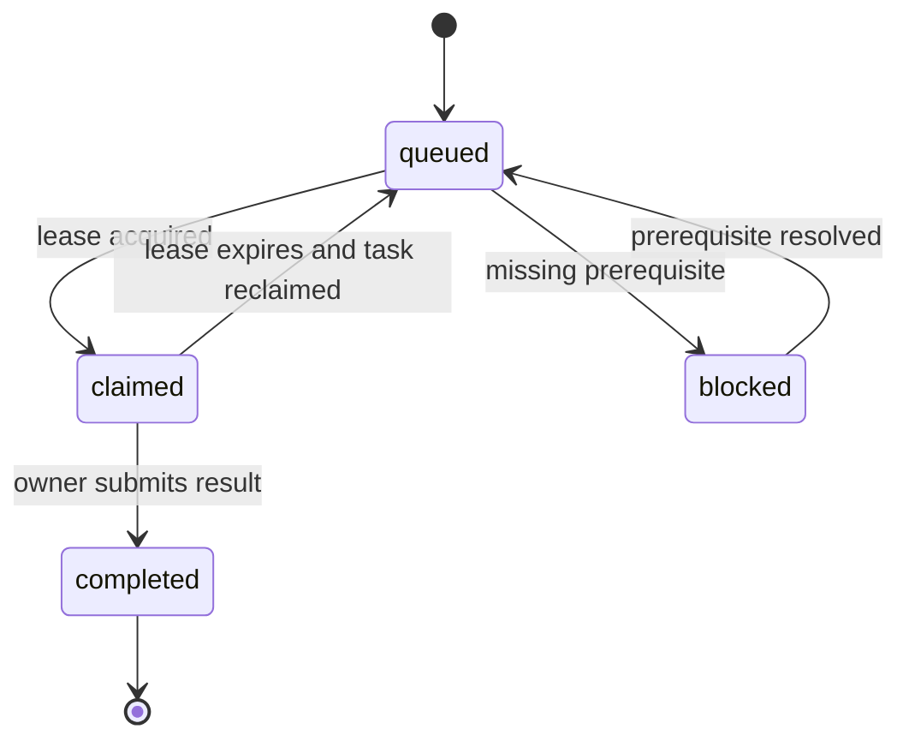

# Shared research and second-model handoff

Date: 2026-10-29. The repository is the shared artefact boundary. Creating this protocol does not attach a separate ChatGPT session, select a model, send an inter-chat message or start a background process.

## Collaboration contract

Use one canonical branch and one work-package ID per bounded question. The coordinator assigns an exact cohort, time period, hypothesis, approved source families, expected output schema and acceptance test. A task may have one active owner. Other researchers can inspect its public outputs and propose independent reviews, but they must not overwrite a live owner's files.

The engine's local SQLite task ledger supports atomic leases within a single shared database. Two machines with separately copied SQLite files do **not** share locks. For parallel separate ChatGPT sessions, use a single coordinator to assign disjoint tasks and exchange committed artefacts; alternatively deploy a shared transactional task service later. Git branches and PR review remain the conflict-resolution boundary. Do not pretend two offline task databases provide global exclusivity.

## Task state machine



The CLI implements a bounded subset of this lifecycle; see its README for supported commands. A reviewer creates a new review/correction task rather than silently reopening and overwriting a completed result. A research result may be closed or disproved while the work task is successfully completed.

## File and identity conventions

- Agent identity is a named role/session, not a claim of a particular model version. Record the user-selected model only when actually known.
- Work package IDs are stable, for example `WP-007`. Branches may use `research/us-integrity/WP-007-short-topic`.
- Each result records task ID, agent/session, base commit, input source IDs/hashes, retrieval time, hypothesis, method, direct findings, inferences, falsification, missing data, output paths and recommended next task.
- A graph ID is a stable entity/assertion identifier. It must not be replaced with an Obsidian display title. A source reused by several agents remains one source with multiple supporting edges.
- Output payloads include `visibility`, `legal_status` where applicable, and `source_ids`. Missing fields block promotion into the public canonical graph.

## Local usage

From repository root, after the graph and task board exist:

```bash
python research/us-integrity/engine/integrity.py validate research/us-integrity/data/graph.json
python research/us-integrity/engine/integrity.py build research/us-integrity/data/graph.json --output /tmp/us-integrity-build --tasks research/us-integrity/architecture/tasks.json
python research/us-integrity/engine/integrity.py claim-task --db /tmp/us-integrity-build/graph.sqlite --task WP-001 --owner session-a --lease-seconds 1800
python research/us-integrity/engine/integrity.py search --db /tmp/us-integrity-build/graph.sqlite "Medicare"
python research/us-integrity/engine/integrity.py complete-task --db /tmp/us-integrity-build/graph.sqlite --task WP-001 --owner session-a --lease-token TOKEN_FROM_CLAIM --result "Result path and review evidence recorded"
```

Use the actual database path produced by the engine. The claim response contains a fencing `lease_token`; completion must present that token and owner. An expired/reclaimed worker cannot complete another lease. Build outputs are reproducible, but live coordination state requires backup. The importer preserves unchanged task claims/completions on rebuild; review the engine README and test this behaviour before rebuilding over a live coordination database. Start an agreed coordination session with one database and keep its path stable for that session.

## Independent review

The researcher submits evidence plus a precise claim. The checker verifies the original documents, dates, units, scope and entity links. It tests at least two plausible innocent/data-quality explanations or explains why alternatives are inapplicable. It returns `supported_as_worded`, `supported_with_narrowing`, `unsupported`, `contradicted` or `needs_more_evidence`, with source-backed rationale.

The coordinator resolves extraction errors and keeps substantive disagreement in a dispute record. Neither model obtains authority to contact targets, publish novel allegations or submit tips. A human decides whether a restricted packet is ready for counsel or an appropriate official route.

## Handoff to the other ChatGPT session

Use [SECOND-MODEL-HANDOFF.md](../agents/SECOND-MODEL-HANDOFF.md). Share the branch URL and selected task; the other session must read the current files and actual source records. Sharing this public branch is not a request to investigate private individuals. Restricted case details need a separately authorized workspace and cannot be passed through a public PR.

## Merge procedure

Before any graph mutation, refresh the branch and check for changed source/entity IDs. Write an additive evidence patch rather than a full graph replacement when other work is active. Run validation and the deterministic build, inspect changed notes and verify source citations. A reviewer confirms privacy class, legal wording, financial measure and entity linkage. Commit the reviewed patch with task IDs. If a conflict arises, preserve both assertions with provenance until the discrepancy is resolved; do not resolve by accepting whichever model wrote last.
