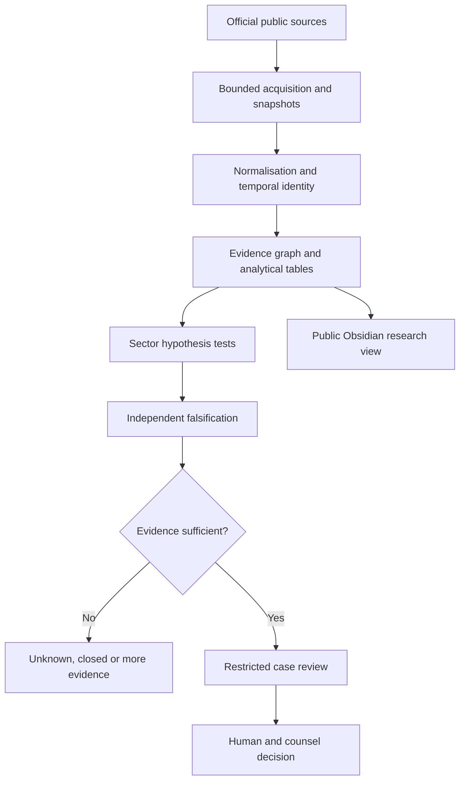

# US Integrity Research System — architecture decision record

Date: 2026-10-29. Status: design specification plus an implemented local research foundation. This is a separate research domain inside PipeMind, not a change to the hydrogen engineering product or a claim that Wong/APEX is operating this system.

## Goal and boundary

Build an evidence-preserving public-funds research system that can follow an agency, programme, award, recipient, subcontractor, corporate relationship, product and location through dated public records. Produce reproducible research leads and falsification records. A risk indicator is not a finding of fraud. A charge is an allegation; a settlement can resolve allegations without an admission; a conviction establishes only the conduct and defendants covered by the judgment.

The request to trace every buyer and every owner nationwide is not a finite deliverable that public data can support. Procurement awards omit some underlying purchases; subaward reporting is incomplete; private companies do not publish full sales ledgers; ultimate beneficial ownership is often unavailable. The system therefore records coverage denominators and explicit unknown edges. It must never manufacture a complete chain to make a graph look finished.

Start with a national catalogue and three bounded cohorts: one federal procurement product family, one DME/home-health provider cohort, and one grant programme. Enumerate the entire selected cohort before scoring it. Expand only when extraction, entity matching and false-positive controls pass the acceptance tests. No political, ethnic, nationality or geographic stereotype determines suspicion.

## Delivery status

| Component | Current status | Evidence required before calling it operational |
|---|---|---|
| Sector research and published examples | Seed research in this branch | Source registry and notes reviewed |
| Canonical JSON graph, local SQLite/search and Obsidian export | Local foundation; see engine README and validation report | Executed tests and repeatable local build |
| Specialist agents | Versioned specifications and task contracts | A real runner invokes them and records reviewed output |
| Bounded USAspending connector | See connector code, manifests and execution report for actual sampled awards | Contract tests, captured response hashes and clearly limited cohort queries |
| Other external data connectors | Planned | Adapter contract test, live bounded extraction, pagination ledger |
| Autonomous monitoring or recurring crawls | Not deployed | Authorized scheduler, credentials, quotas and monitoring |
| Second ChatGPT collaboration | Shared-file handoff and task protocol | Other session opens this branch and claims a task |
| Wong/APEX integration | Proposed read-only bridge | Separate integration test against the actual runtime |
| Novel company-level investigation | Not represented by published seed cases | Restricted evidence store and case-specific review |
| Reward eligibility or fraud determination | Not decided by this software | Applicable agency/court/counsel assessment |

## System topology

Each output records exact input versions. An agent cannot promote its own output into an adjudicated fact. Public notes include source summaries and already published case histories; restricted workspaces hold novel named allegations, confidential tips, legal analysis and any authorized non-public material. Restricted information never flows through the public Obsidian export.

## Storage model

1. **Source registry:** persistent source IDs, publisher, title, canonical URL, publication date, retrieval date, jurisdiction, access method, licence/terms, expected update rate and limitations. A retrieved webpage citation is evidence of consultation, not a byte-preserved archive.
2. **Raw object store, planned:** immutable response bytes under a SHA-256 content address, with request URL/body, response headers, UTC retrieval time, HTTP status and cursor. Restricted objects require encryption, access logging and independent retention policy. Never put API keys or authorization headers in manifests. Do not claim raw hashes where bytes were not captured.
3. **Landing tables:** original column names, original string values, batch ID and source row ID. Preserve leading zeros. Reject malformed rows to quarantine with reason; never silently drop them.
4. **Normalised tables:** awards, award actions, payments, subawards, provider measures, grants, audits, identities, ownership assertions and case events. Each table includes business-valid time and observation time.
5. **Canonical evidence graph:** `data/graph.json` is the reviewable public interchange format. SQLite is a rebuildable local index, not the sole authoritative record. A future transactional database should use the same IDs and append-only assertions.
6. **Research notes:** one Obsidian note per graph node, generated from the canonical graph. Notes describe facts, uncertainty, sources, incoming/outgoing relationships and the next falsification step. Narrative playbooks supplement nodes; they do not replace structured evidence.
7. **Task/event ledger:** task version, assignee, lease, input hashes, output paths, review decision, disagreements and final handoff. Coordination data is operational metadata, not evidence that a claim is true.

Use object storage and columnar analytical files when datasets exceed a laptop's capacity. Do not import all national transaction rows into a large language model context or a note vault. Store granular data once; notes point to bounded query results and reproducible extracts. A graph database is an optional projection when path workloads justify it; adding Neo4j is not a prerequisite for the first cohort.

## Canonical entities and edges

The interchange root is `{version, as_of, nodes, edges}`. A node contains `{id, type, title, status, source_ids, properties}`. An edge contains `{id, type, source, target, status, source_ids, properties}`. IDs remain immutable when display names change. Use safe namespace prefixes such as `src-`, `agency-`, `programme-`, `award-`, `action-`, `entity-`, `person-`, `product-`, `location-`, `case-`, `hypothesis-`, `method-` and `task-`. Current engine IDs begin with a letter and then use letters, digits, underscores, dots or hyphens; colons, slashes and `..` are rejected. The engine's validator is authoritative for which characters and statuses are currently accepted.

Important entity types: agency, office, programme, award, award_action, recipient, provider, legal_entity, corporate_group, person_public_role, product, facility, geography, source, source_record, claim, audit_finding, published_case, hypothesis, reward_route and research_task. A person is included only for a documented public business role material to the research; never enrich home addresses, personal contact details, family connections or unrelated personal life.

Important edges: `funds`, `awards`, `recipient_of`, `subaward_to`, `bills`, `supplies`, `operates`, `located_at`, `reported_parent_of`, `reported_owner_of`, `officer_of`, `cites`, `supports`, `contradicts`, `tests`, `alleges`, `settles`, `convicted_of`, `supersedes` and `same_entity_candidate`. Every nontrivial evidentiary assertion carries its own sources. Do not infer ownership from a registered-agent relationship, shared address, common surname or a parent-UEI field alone.

Identity key hierarchy:

| Domain | Strong keys | Context required | Never sufficient alone |
|---|---|---|---|
| Federal recipient | UEI; historical DUNS with date | Register and effective period | Normalised company name |
| Procurement | Award unique key; agency + PIID + referenced IDV | Modifications and awarding office | PIID without agency/context |
| Supplier | CAGE/NCAGE and legal entity registry ID | Site vs legal entity; valid dates | Shared industrial estate |
| Healthcare | NPI; CCN; state Medicaid provider ID | NPI type, location and programme | NPI-to-owner shortcut |
| Product | NSN/NIIN, part number plus manufacturer, HCPCS/NDC | Version, package, unit and date | Same plain-English description |
| Corporation | State + registry ID; SEC CIK/LEI where present | Jurisdiction and corporate event date | Registered agent or filing service |
| Grant | Award ID/FAIN, Assistance Listing, recipient UEI | Funding agency and subrecipient | Similar project title |
| Location | Geocoded business/facility record | Source accuracy and effective date | County, postcode or map proximity |

## Temporal entity resolution

Keep each source's raw identity, alias and effective period. Resolve exact authoritative identifiers first. Generate possible matches with normalised names and business locations, but require independent review before a fuzzy candidate merges. Corporate acquisition after an alleged transaction does not establish ownership at the transaction time. Store `valid_from`, `valid_to`, `observed_at`, `asserted_by`, `resolution_method` and `resolution_confidence`; missing dates remain unknown.

Maintain reversible merge decisions with input records, reviewer, rationale and contrary evidence. Never delete the losing identity. Treat address clustering as a candidate-generation tool and test for accountants, registered agents, co-working premises, hospital campuses and corporate service centres. Do not treat a corporation's subsidiary revenue as its federal award revenue without a documented consolidation rule.

## Money, scale and denominators

Store decimal amounts as strings with currency, unit, measure, accounting basis, fiscal/calendar period and source. Do not sum incompatible measures. Award ceiling, obligation, outlay, loan face value, loan subsidy cost, billed amount, paid amount, alleged loss, adjudicated loss, restitution ordered, settlement total, forfeiture and cash recovered are distinct fields.

Transactions are not independent awards. A modification may deobligate money; an indefinite-delivery contract ceiling is not actual spend; a subaward may already be included in its prime award. Contract and subcontract totals must not be added into a single recovered-loss figure. Deduplicate corrections by source business keys and version; preserve the correction history. Attribute case-level dollar figures to the exact defendants and conduct described; do not attribute all of a national enforcement action's alleged billing to one participant.

A price outlier must control for unit of issue, pack size, quantity, quality/testing, specification, hazardous handling, emergency delivery, location, inflation, lifecycle support, installation, warranty, restricted rights and contractual risk. High margin or a high price alone is not fraudulent. A corporate stock price, insider trade or political donation does not prove procurement misconduct.

Every cohort report must state the queried period, inclusion rules, source row count, unique entities, missing identifiers, excluded records, late reporting window, suppressed records and matched/unmatched percentages. Missing ownership is an unknown, not a negative finding and not evidence of concealment.

## Source adapters and API contract

Planned adapters should expose `discover()`, `fetch_page(request, cursor)`, `normalise(raw_record)`, `checkpoint()` and `manifest()`. Store query body and API version. Use documented public APIs and official bulk files first. Respect source terms, rate limits and robots restrictions; never bypass authentication or scrape a private system. API availability, thresholds and schemas must be rechecked against the source registry before coding.

The bounded USAspending implementation is a seed acquisition path, not a national audit pipeline. Current runs may include medical-supplies, defence-parts and HHS-grant award samples; a capped sample is not the complete cohort required for stronger conclusions. Priorities for further adapters: USAspending complete awards/actions/subawards; SAM entity/contract-award public data; CMS provider/DME/ownership public files and NPPES; HHS public Medicaid files where access and coverage are documented; Federal Audit Clearinghouse; NIH RePORTER/NSF; SBA pandemic public files; official OIG/DOJ case documents; SEC EDGAR for public corporate relationships. State registries and state programme systems need per-jurisdiction adapters. FinCEN BOI is not a public ownership feed.

Completeness controls: record pagination cursor and page count; stop on repeated cursors; compare reported totals to acquired counts; store duplicate counts; resume only from committed batches; honour 429 `Retry-After`; bounded exponential backoff on transient errors; quarantine schema changes; fail closed on missing required identifiers. A partial acquisition is explicitly labelled partial and cannot support a full-population conclusion.

## Read-only Wong/APEX bridge

Do not connect the fraud domain directly to hydrogen operational controls or import arbitrary research documents as agent instructions. Proposed bridge returns approved public source summaries, evidence IDs and immutable report links through a domain-scoped read interface. Tools have separate credentials, allowlists, quotas and audit streams. No source content can grant tool permissions. Restricted cases require a distinct store and access policy; they are excluded from general personal-assistant memory and public repository search.

An existing integration branch is evidence of a proposed integration, not proof of a live shared brain. This branch adds portable contracts so a future implementation can be tested independently. Build a compatibility adapter only after checking the current Wong/APEX runtime and its repository instructions.

## Acceptance gates

The first operational pilot passes only when: (1) the cohort is bounded and enumerated, (2) exact source queries and transformations reproduce its counts, (3) all material assertions cite source records, (4) entity matches and money measures pass independent review, (5) alternative explanations are tested, (6) privacy/publication classification is correct, and (7) a second reviewer can reproduce the result without adopting the first analyst's conclusion. Finding no fraud is a valid successful outcome.

See [OPERATIONS-AND-SECURITY.md](OPERATIONS-AND-SECURITY.md), [MULTI-AGENT-PROTOCOL.md](MULTI-AGENT-PROTOCOL.md), [BUILD-ROADMAP.md](BUILD-ROADMAP.md) and [AGENT-REGISTRY.md](../agents/AGENT-REGISTRY.md).
