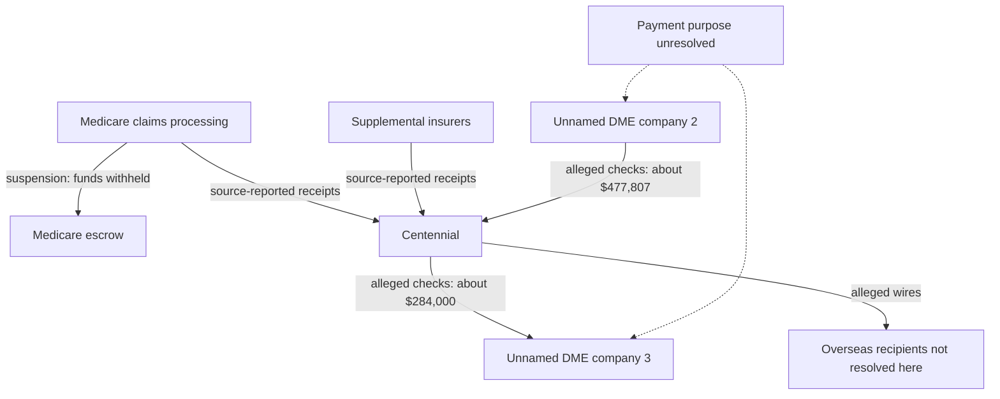

# Catheter supplier investigation: the strongest public evidence trail

**Research date: 29 October 2026.** This investigation selects the Centennial Med Supply / Operation Gold Rush branch for deeper work because it combines public charging documents, exact supplier identifiers, independently queryable administrative records and a specific unresolved transaction trail. Selection measures the usefulness of the evidence, not a calculated probability of guilt. This is an existing government investigation; this work has not discovered a new prosecutable fraud or established a reward entitlement.

Six specialist workers were assigned to data acquisition, case tracing, entity resolution, enrollment checks, independent falsification and graph integration. Their work and handoff conditions are recorded in [RUN-LEDGER.md](RUN-LEDGER.md). Findings are separated in the generated Obsidian vault through the explicitly approved investigation graph extension.

## What the deeper work established

1. **The public catheter data contains an extreme, reproducible concentration change.** All 6,870 published supplier/service rows for A4351, A4352 and A4353 in 2022–2024 were acquired, with filtered counts and an empty next page confirming each extraction. A4353's reconstructed Medicare payment measure increased from $39.18 million to $3.057 billion in 2023. Nearly all the net increase came from newly observed NPI/code/rental combinations. This identifies a historical structural break; it does not establish new businesses, fraudulent claims or actual cash loss.
2. **The Centennial branch offers a more specific transaction question.** Paragraph 47 of the Danelia complaint describes approximately $477,807 received from one unnamed DME company and approximately $284,000 sent to another. The filing expressly leaves the purpose under investigation. The companies remain unidentified in this research; similar names, addresses or amounts are not sufficient to identify them. See [case trace](case-trace/REPORT.md).
3. **Administrative records independently anchor the published company identities and dates.** Exact NPI checks match Centennial to a Medicare revocation effective 24 October 2025 and ND Medical Solutions to a revocation effective 23 April 2025. Centennial also has an exact-NPI OIG exclusion match effective 11 July 2026. NPPES records remain active: NPI enumeration, Medicare billing eligibility and exclusion are different statuses. See [identity](identity/REPORT.md) and [enrollment](enrollment/REPORT.md).
4. **The money must be split by payer and accounting state.** The original charging documents describe approximately $1.039 million in Medicare receipts and at least approximately $11.551 million from supplemental insurers for Centennial. ND's alleged receipts split into approximately $0.567 million from Medicare and $5.945 million from other insurers. These are source-reported alleged receipts, not independently reconciled bank balances, adjudicated loss or collected recoveries.
5. **Several tempting conclusions failed review.** Of 83 NPIs newly visible for A4353 in 2023, 44 already appeared under A4351 or A4352 in 2022: newly visible code activity is not necessarily a new business. A4352 is itself affected by a large increase, so it cannot serve as an unaffected control. GAO reports that CMS began sharing suspension information with supplemental payers in December 2025/January 2026, so an old information gap cannot simply be declared unchanged today. See [independent review](falsification/REPORT.md).

## The data test, with its denominator

The observation is an annual supplier NPI × HCPCS code × rental indicator in Original Medicare fee-for-service Part B. It is not an invoice, bank transfer, unique patient, complete company account or all-payer sales record. The acquisition requests omit names, street addresses, contact details and patient information. NPIs are retained as public professional identifiers for exact joins. No named ranking of previously unaccused suppliers is published.

The amount below is reconstructed as `sum(Tot_Suplr_Srvcs × Avg_Suplr_Mdcr_Pymt_Amt)` using decimal arithmetic. CMS calls the average a Medicare payment measure. The public file does not reconcile cash release, payment suspensions, escrow, recoveries or secondary-payer receipts; those cannot be inferred from these totals.

| Code and item | 2022 rows / measure | 2023 rows / measure | 2024 rows / measure |
|---|---:|---:|---:|
| A4351: straight-tip intermittent catheter | 1,483 / $114.82m | 1,382 / $135.46m | 1,297 / $120.82m |
| A4352: curved-tip intermittent catheter | 567 / $265.58m | 586 / $705.05m | 569 / $188.69m |
| A4353: intermittent catheter with insertion supplies | 322 / $39.18m | 332 / $3,057.36m | 332 / $1,153.54m |

Source: [captured analysis](data-audit/analysis.json), [acquisition manifest](data-audit/acquisition_manifest.json), and [reproduction instructions](data-audit/REPORT.md). These are totals of the published supplier detail, not complete national payment totals.

For A4353, the ten largest suppliers by exact NPI account for 46.88% of this measure in 2022, 92.65% in 2023 and 96.88% in 2024. From 2022 to 2023, services rise 7,048.23% and the payment measure rises 7,704.07%. The weighted measure per service changes from $6.52 to $7.12. Volume and concentration, rather than unit price alone, are therefore the principal descriptive change.

The exact annual decomposition is:

| Component, 2022 → 2023 A4353 | Reconstructed amount |
|---|---:|
| Net increase | $3,018,186,282.67 |
| 83 newly observed NPI/code/rental rows: 2023 amount | +$3,017,853,044.53 |
| 249 rows present in both years: net change | +$1,592,634.97 |
| 73 rows no longer observed: prior-year amount removed | −$1,259,396.83 |

This equality is an accounting decomposition of public rows. An entrant could be a longstanding business first appearing for this code, crossing a disclosure threshold, changing its service mix, or using another identifier. It is not necessarily a newly formed supplier. The cross-code check demonstrates this distinction: 44 of the 83 NPIs newly visible for A4353 in 2023 already appeared in the prior year's A4351/A4352 cohorts; 33 of 55 newly visible in 2024 did likewise. These observations do not establish whether any code change was clinically appropriate. For matched A4353 rows with at least $100,000 in the prior-year measure, median growth is only 0.30%; that makes a uniform market-wide growth explanation less consistent with the observed distribution, while leaving several nonfraud explanations open.

National geography/service totals independently reveal suppression undercoverage. A4353 supplier detail represents approximately 95.84%, 99.94% and 99.85% of the corresponding national payment measures in 2022, 2023 and 2024. All published detail was retrieved, but it is still not every supplier's activity. Missing detail is not zero. The methodology and dictionary have inconsistent wording about disclosure thresholds; the observed schema and blanks are preserved rather than silently choosing one wording. Beneficiaries overlap across suppliers/codes and are never added as unique people. See [national reconciliation](data-audit/national_reconciliation.json).

An independent worker recomputed all nine aggregates and all six annual matched/entry/exit decompositions from saved rows, including concentration and unit measures, and independently checked two cross-code controls and nine national payment reconciliations. Its results and final input hashes are in [data_review.json](falsification/data_review.json).

## The company and money trail

### Identity anchors

| Attribute | Centennial Med Supply, LLC | ND Medical Solutions LLC |
|---|---|---|
| Exact NPI | 1609626167 | 1790533503 |
| Business state | Colorado | Pennsylvania |
| Public enforcement context | Bendeliani indictment / Danelia complaint | Gugava indictment |
| Medicare revocation effective | 2025-10-24 | 2025-04-23 |
| Published re-enrollment bar expiry | 2035-10-23 | 2035-04-22 |
| Exact NPI OIG LEIE match in retrieved snapshot | Yes; exclusion 2026-07-11 | No exact match; not clearance |

Source-selected responses and dated retrieval records are in the identity and enrollment folders. The revoked-enrollment snapshot is the current September 2026 version, modified 21 October 2026, rather than the stale first-quarter version returned by some indexed pages. Entries describe particular enrollments and snapshot dates, not universal current eligibility decisions.

Centennial's exact Colorado business match is entity **20241008944**, formed **2 January 2024**, currently labelled **Delinquent**, with **Kakha Bendeliani** listed as registered agent. NPPES reports an authorized official with a spelling variant. The indictment supplies the alleged nominee-owner role; the corporate and NPI records do not independently establish beneficial ownership or criminal responsibility. Delinquent corporate status by itself is not a fraud finding. New Hampshire is the prosecution venue, not Centennial's business state.

For ND Medical, NPPES lists **Erekle Gugava** as authorized official/president, while DOJ alleges purported ownership during February–July 2025. The official-role record corroborates a professional association, not the complete control or beneficial-ownership chain. The identity report preserves small source discrepancies rather than forcing dates or names to agree.

### Additional enrollment screen and follow-through

The acquisition reconciled **8,620 revoked-enrollment rows and 94 companion NPI rows**. Among 1,976 distinct NPIs in the historical catheter cohorts, 64 have an exact match in the current revocation snapshot. This is not a fraud rate: later revocations cannot establish earlier ineligibility, and a current list is not a complete history.

In 2024, 34 catheter suppliers match the current snapshot: 26 revocations became effective after 2024, six during it and two before it. The last two correspond to approximately **$1.924 million of annual public-file payment measure**. We followed both through three public approved-enrollment versions, the latest additional-NPI file and bounded public appeal searches. One has a different approved enrollment restricted to mass-immunization roster billing; that does not establish permission for catheter supplies. The other has no hit in those selected approved-enrollment snapshots. Neither result establishes historical 2024 eligibility, the enrollment actually billed, or cash received after revocation. No conclusive appeal decision resolved either record. The candidates remain anonymous in the public findings. See [follow-up evidence](enrollment/candidate_followup_summary.json).

This is an unresolved enrollment-reconciliation question, not a $1.924 million loss finding. Its next necessary evidence is the billed enrollment identifier and historical decision/notice/appeal timeline, followed by claim and cash reconciliation. ND's observed 2024 row also predates its alleged 2025 ownership change; it is not evidence of the named defendant's conduct in 2024. Centennial has no observed rows in this 2022–2024 three-code extract, which cannot determine its later billing.

### Transactions and missing links

This diagram summarizes allegations and a payment mechanism in the complaint, not independently obtained bank records. It deliberately avoids assuming that money entering one account is the same money leaving another. No total loss is calculated from the arrows.

The complaint's Medicare claims figure includes approximately $1.2 billion described as paid in processing data but overwhelmingly held in escrow after suspension. Treating this figure as money received by the business would materially overstate receipts. The separate indictment's receipt figures and the complaint's claims-processing figure have different bases and reporting windows; they are preserved as separate measures.

The most useful unresolved branches are therefore:

- **Intercompany purpose:** whether the two DME-to-DME movements represent inventory, services, loans, refunds, revenue transfers or proceeds movement. The public complaint does not settle the purpose, provide the counterparties' identities, or establish invoice support.
- **Payer timing:** receipts before and after each payer learned of a suspension or revocation, with claim/service/processing/disbursement dates separated. An annual 2024 file cannot answer a 2025 transaction question.
- **Government versus private exposure:** Medicare, Medicaid, CHAMPVA/TRICARE, Medigap, employer and union funds must retain separate payer classifications. Government-supported insurance is not a license to classify every private payment as federal loss.
- **Control and disposition:** who exercised control over the companies and the recipients at the transaction date, followed by amounts actually frozen, returned, forfeited or collected. Nominee-owner allegations, corporate agents and authorized banking roles are distinct relationships.

The [case evidence register](case-trace/evidence_records.json) supplies paragraph/page locators, amount types, status dates and overlap cautions. Gold Rush umbrella totals and component-company totals are not additive. A scheduled sentence is not a sentence imposed; a forfeiture order is not money collected. Later DOJ releases update several participants to pleas or sentences without changing the status of every other defendant.

## Why the other apparent leads rank lower

| Candidate | Publicly testable now | Limitation | Decision |
|---|---|---|---|
| Centennial secondary-payer/intercompany branch | Named court filings, exact NPI, corporate record, revocation and exclusion | Transaction counterparties and cash reconciliation incomplete | Selected case trail |
| 2022–2024 catheter supplier concentration | Complete published cohorts and national comparator totals | Historical aggregate; no delivery, orders or payment-release dates | Completed quantitative test; useful calibration |
| Eleven suppliers in CMS's September 2026 $3.4bn announcement | Official scheme-level description | Suppliers unnamed; nonpublic Preclusion List cannot be reconstructed by guessing | Preserve as unresolved watch item |
| Broad revoked-provider payment vulnerability | Current public revocation list plus OIG audit | Part C/D claims and actual preclusion timing unavailable in this public analysis | Separate audit workstream; not attributed to these companies |

The OIG audit issued 28 September 2026 describes $72 million in Part C/D payments associated with 249 of 1,017 reviewed revoked NPIs during 2022–2024. Its $72,004,603 total includes $42,021,169 associated with twelve pharmacy NPIs where the described rules did not prohibit payment for filling eligible prescriptions. The total therefore cannot be labelled $72 million of established fraud or prohibited payments. The other categories concern timing/errors and organizational ownership rules. See the [official audit](https://oig.hhs.gov/documents/audit/11934/A-02-24-01013.pdf), printed page 7 table (PDF page 9). This is a separate historical population; it neither proves these two suppliers were paid after revocation nor supplies their loss amounts. The current public revoked-enrollment file and the CMS Preclusion List are different products with different access and meaning.

## What would change the conclusion

[FOLLOW-UP-QUEUE.json](FOLLOW-UP-QUEUE.json) lists finite research questions, required evidence and outcomes that would close or downgrade a lead. It includes updated public court filings, published forfeiture/restitution records, historical enrollment timelines, later CMS utilization years and documented payer-notification implementation.

The evidence needed to prove new underlying fraud is more specific than a high spending rank: a false claim or false representation, the relevant person's knowledge/control, absence of legitimate fulfillment or entitlement, payer-specific disbursement, and a defensible loss/recovery calculation. Public annual aggregates do not supply that complete chain. No patient record, private bank record, account credential or restricted claims system was accessed in this run. No tip or report was submitted.

The useful result is a reproducible historical concentration test and a substantially better documented existing-case trail, including exact administrative joins and unanswered transaction questions. **New fraud established: zero. New recoverable federal savings established: none.**
