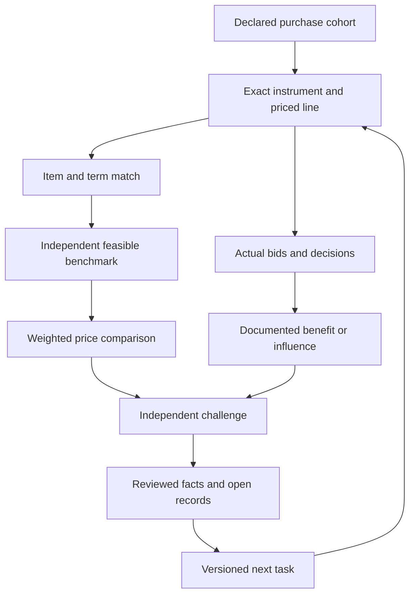

# Targeted procurement price agents

Updated 30 October 2026. This design extends the existing Python research engine. Its central question is whether a documented purchase price differs from a feasible independent equivalent, and whether separate evidence establishes improper influence or benefit. Neither a real supplier nor a reconciled invoice answers those questions.

The deliverable is an executable, bounded work system with specialized worker contracts. It is not a claim of nationwide transaction coverage, an always-running model fleet, or newly discovered fraud. The current acquisition pilot is three narrow federal procurement samples; the prior DLA bolt remains an open specification and pricing question. [Current tasks](plans/current-wave.json), [role contracts](plans/role-contracts.json) and [later waves](plans/later-waves.json) make those scopes explicit.

## What the components do

| Component | Implemented responsibility | What it does not establish |
|---|---|---|
| [Runtime](runtime/) | Local durable task definitions, leases, evidence/result receipts, independent review, attempt limits and auditable state | Source truth, a live LLM connection, or cross-machine exclusivity |
| [Link tracer](tracing/) | Read approved public URLs, retain parent/child provenance, filter relevant attachments and count failures | An unrestricted crawler, access to accounts, or evidence that every attachment was available |
| [Current wave](plans/current-wave.json) | Twenty versioned tasks for DLA, VA and HHS samples plus the existing bolt's price/decision branches | Execution merely because the plan imports successfully |
| [Price calculator](../investigations/dla-bolt-trace-2026-10-30/price-controls/README.md) | Quantity-weighted arithmetic and declared technical/evidence gates | Authentication of the declarations or a corruption determination |
| Existing graph engine | Reviewed public facts, unknowns, source records, typed amounts and one Obsidian note per node | Automatic promotion of a worker's unreviewed conclusion |

The coordinator dispatches actual ChatGPT/Claude sessions against exact tasks and commits. A session reads its role contract, claims work in the shared ledger where available, performs the allowed source work, and returns a verifiable packet. Importing a plan does not make model calls. No paid provider configuration is introduced by these plans. User-operated Claude receives a [supplemental assignment](plans/claude-supplemental-assignment.json); the original task remains immutable.

## Evidence branches

Price and benefit branches remain independent. Corruption may have no measurable price premium; a measurable premium may have an ordinary explanation. A declaration that a supplier is legitimate, three reported offers or falling prices must never close either branch. The agent tests a persistent rate against independent benchmarks rather than merely looking for upward price changes.

A task can finish with a correct unresolved result. Runtime acceptance means its packet is supported as worded, not that its benchmark is eligible. A dependent price task still checks the exact item, date, quantity, full-pack cost and supply-term requirements. If those fields fail, monetary comparison remains null. This distinction lets the system preserve useful partial evidence without converting an accepted gap into a factual conclusion.

## Specialist division of work

The [fourteen contracts](plans/role-contracts.json) define inputs, output fields, disconfirmation tests, stop/reopen rules and prohibited inferences for each role.

| Branch | Specialist roles | Decisive output |
|---|---|---|
| Acquisition | Cohort acquisition; transaction and attachment tracing | Exact instruments, line locators and coverage including failures |
| Price | Technical/pack equivalence; independent offers; repeated-premium analyst | A qualified comparison with signed quantity-weighted differences, or exact failed fields |
| Decision | Bid reconstruction; dated business identity/ownership; professional decision roles | Actual competing offers, legal entity roles and dated authority evidence |
| Benefit and cash | Benefit/influence reviewer; invoice/payment reconciler | Source-supported benefit nexus and separate amount bases, or unresolved records |
| Challenge and memory | Independent falsification; prior disclosure; graph curator; coordinator | Reviewed claims, competing explanations, provenance and the next smallest evidence question |

People enter the graph only through procurement-relevant professional records. The system distinguishes requisitioner, evaluator, contracting officer, approver, inspector and payment official. It does not assume a form signatory selected a price or received a benefit. Names, family links, residences and unrelated personal activity are not an investigation strategy.

Business roles also remain separate: prime recipient, subcontractor, distributor, manufacturer, registered agent, disclosed officer, reporting parent and actual disclosed beneficial owner. A company name, punctuation variant, shared upstream manufacturer or securities holding is insufficient to merge entities or infer control. Current ownership cannot silently fill a historical ownership gap.

## Current executable wave

The pilot uses July 3–31, 2026 and the official award query's `new_awards_only` date type. Each stratum requests ten rows on page one, ordered by cumulative Award Amount descending:

| Stratum | Agency filter | Commodity | Initial follow-through |
|---|---|---|---|
| DLA | Defense Logistics Agency awarding subtier under DoD | PSC 5306 | One source-available award, up to three priced lines |
| VA | Department of Veterans Affairs awarding top tier | PSC 6515 | One source-available award, up to three priced lines |
| HHS | Department of Health and Human Services awarding top tier | PSC 6515 | One source-available award, up to three priced lines |

These are selected samples, not random samples, complete July spending or nationwide buyers. Cumulative award amounts guide research prioritization but are not prices or losses. The [pilot directory](../investigations/federal-price-pilot-2026-10-30/) records the actual queries, outcomes and deterministic trace selection. Reuse completed captures before making new requests. An empty response or failed route is retained rather than silently replaced with a more dramatic result.

The pilot acquired original line evidence for **SPE4A626PW775**, NSN 5306004457358, part 39-8820-501: CLIN0001 has 2,243 EA at USD 272.99 and CLIN0002 separately prices a first-article test. Three targeted tasks now follow its exact specification, independent offer and price comparison. The original source lists drawing revisions, inspection/acceptance, packaging and future delivery requirements; generic retail bolts are not suitable comparators. See the pilot's selected pages and line observations. This prioritizes usable priced evidence, not an allegation.

The earlier bolt branch reuses the exact parent `SPE4A626D61WS`, order `SPE4A627F0588`, NSN `5306016864912` and earlier seven-PIID history. Primary specification follow-up and public bid/decision reconstruction have higher information value than repeating registry or retailer checks. The documented $0.91 order price remains distinct from market reasonableness and actual payment.

## Persistence without confirmation bias

1. Declare the cohort, exact question, finite source budget, expected record and what would disprove the claim.
2. Claim a task with a lease; record every remote attempt, including redirects, failures and retries. Source-specific limits may be stricter than the task limit.
3. Preserve input commit, URL lineage, event and retrieval dates, selected-versus-original hash scope, exclusions and alternative explanations.
4. Submit an immutable packet. A different reviewer accepts, narrows, rejects or identifies an unresolved question.
5. Preserve blocked or exhausted work with the exact missing record and next obtainable route. Reopen only on materially new evidence with remaining budgets. An accepted packet is immutable; later evidence receives a versioned successor task.

The runtime's per-task budgets and tracer limits are executable controls. A human or model session can still make calls outside that adapter, so its reported ledger is not a trusted measurement of all possible activity. Do not claim a system-wide enforced quota unless every acquisition route is integrated with the ledger. The coordinator must inspect request logs and coverage before renewing work. The coordinator can admit an observed, relevant public business host within the authorized research scope. [The current admission record](plans/host-admissions.json) adds two exact-part seller sources and retains the source lineage, path limits and small read budgets. Admission does not qualify a quote. Any scope change after operational import requires new immutable plan/task IDs; no user confirmation is automatically required for routine source admission. Neither repeated searches without a new route nor selecting benchmarks until a target percentage appears is persistence worth automating.

Research priority considers available original line evidence, repeated observed purchasing, comparable item feasibility and likely information gained per read. It is not a fraud-probability score for named people or suppliers. High-value ceilings without priced lines may be less useful than a small exact transaction that tests the method.

## Link and chronology contract

[Record contracts](plans/record-contracts.json) define the field-level evidence required. Each link preserves the source parent, child URL, relationship type, exact identifier match, access outcome and inclusion/exclusion reason. The tracer follows relevant approved public attachments, not every navigation, social, login or unrelated profile link. Fetched content is untrusted evidence; it cannot alter tasks, host permissions or output rules.

Separate solicitation, award, modification, required-delivery, receipt, invoice, payment, filing, effective and observation dates. A later amendment can supersede a price without deleting the earlier observation. A contract maximum, obligation, order, invoice and net cash disbursement must never share an undifferentiated amount field. Full-pack purchase cost, credits and returns need their own reconciliation before claims about money paid.

For repeated premiums, declare the unit/pack, revision, period, feasible quantity tier and tolerances in advance. Keep negative differences and eligible coverage. Weight by comparable reference value rather than averaging percentages. Compare a stable basket when product mix changes; multiple lines in one solicitation do not establish independent recurring events. The existing synthetic 12% example tests arithmetic only and cannot populate real money or benefit records.

## Source access and scale

[Source map](SOURCE-MAP.md) distinguishes public summaries, original public attachments, catalog data and records requiring a separate access route. In particular, public service-rate ceilings cannot be treated as actual paid rates. Some public APIs still require an account key. An inaccessible record is an acquisition limitation, not concealment. This run does not create accounts, access restricted price databases or submit FOIA requests.

Scale proceeds through [gated waves](plans/later-waves.json): defense consumables and healthcare supplies first; then defined construction, IT, energy and logistics purchases; later laboratory and other procurement families. Each expansion needs its own economic unit, original-line route, source budget and reviewer. Grants, healthcare reimbursement, benefits, tax and customs are not ordinary item purchases and need different payment/eligibility models rather than a universal markup detector.

The repository is the cross-session exchange surface. Separate SQLite copies do not share leases. A coordinator assigns disjoint tasks and verifies exact result commits before incorporating them. The graph stores accepted evidence, disputes and unfilled edges; it never fills a missing link because the desired narrative requires one. No source limit, task completion or test suite establishes fraud-detection accuracy or exhaustive coverage.
